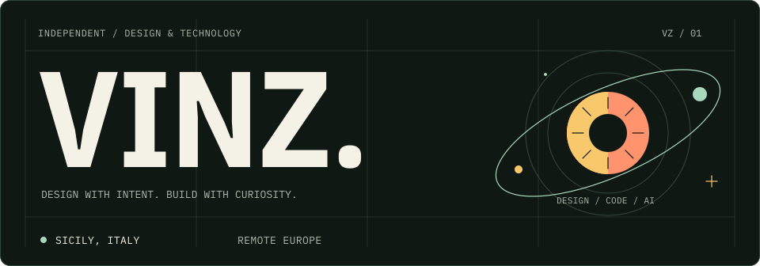
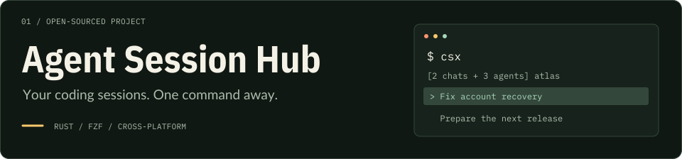
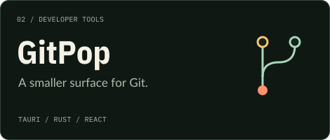
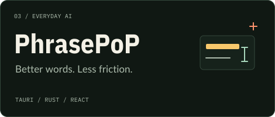

<picture>
  <source media="(prefers-color-scheme: dark)" srcset="assets/profile-hero-dark.svg" />
  <source media="(prefers-color-scheme: light)" srcset="assets/profile-hero-light.svg" />
  
</picture>

<h3 align="center">Senior UX/UI &amp; Product Designer · Creative Technologist</h3>

  Financial products · B2B workflows · AI-assisted prototypes 
  <strong>Sicily, Italy</strong> &nbsp; / &nbsp; Remote Europe &nbsp; / &nbsp; Open to remote contracts

  <a href="https://www.vcreative.it/"><strong>VIEW PORTFOLIO ↗</strong></a>
  &nbsp;&nbsp;·&nbsp;&nbsp;
  <a href="mailto:vinzify@gmail.com"><strong>LET'S TALK ↗</strong></a>

I design the interface, build the prototype, and work through the details that make it useful. My projects sit between product design, creative coding, and practical AI tools.

## Open-sourced projects

<a href="https://github.com/vinzify/Agent-Session-Hub">
  <picture>
    <source media="(prefers-color-scheme: dark)" srcset="assets/project-session-hub-dark.svg" />
    <source media="(prefers-color-scheme: light)" srcset="assets/project-session-hub-light.svg" />
    
  </picture>
</a>

Find, preview, and resume local coding sessions from one terminal picker. Workspace grouping, connected agent trees, and storage cleanup keep a growing history manageable. [Explore Agent Session Hub →](https://github.com/vinzify/Agent-Session-Hub)

<table>
  <tr>
    <td width="50%" valign="top">
      <a href="https://github.com/vinzify/gitpop">
        <picture>
          <source media="(prefers-color-scheme: dark)" srcset="assets/project-gitpop-dark.svg" />
          <source media="(prefers-color-scheme: light)" srcset="assets/project-gitpop-light.svg" />
          
        </picture>
      </a>
      
Review changes, generate AI-assisted commit messages, and commit or push from a focused Windows context-menu app.

      <a href="https://github.com/vinzify/gitpop"><strong>Explore GitPop →</strong></a>
    </td>
    <td width="50%" valign="top">
      <a href="https://github.com/vinzify/PhrasePoP">
        <picture>
          <source media="(prefers-color-scheme: dark)" srcset="assets/project-phrasepop-dark.svg" />
          <source media="(prefers-color-scheme: light)" srcset="assets/project-phrasepop-light.svg" />
          
        </picture>
      </a>
      
Rewrite selected text and draft replies with local or cloud AI models, from a lightweight desktop interface.

      <a href="https://github.com/vinzify/PhrasePoP"><strong>Explore PhrasePoP →</strong></a>
    </td>
  </tr>
</table>

## Open-source contributions

### [drift](https://github.com/phlx0/drift) · terminal screensaver

I contributed **orrery**, a configurable solar-system scene rendered in terminal braille characters, with planetary trails, asteroid and UFO flybys, documentation, and regression tests.

| Pull request | Contribution | Status |
| --- | --- | --- |
| [phlx0/drift #33](https://github.com/phlx0/drift/pull/33) | Added the orrery scene | Merged · March 2026 |

## Toolkit

| Design & creative | Engineering & prototyping |
| --- | --- |
| UX/UI · interaction flows · product prototypes | React · Next.js · TypeScript · Tailwind CSS |
| Figma · Adobe Creative Suite · Rive | Tauri · Rust · Python · GitHub Actions |
| AI-assisted prototyping · ComfyUI | React Native · Expo · Ollama |

<strong>A little activity, a little play</strong> — contribution graph

<picture>
  <source media="(prefers-color-scheme: dark)" srcset="https://raw.githubusercontent.com/vinzify/vinzify/output/github-snake-dark.svg" />
  <source media="(prefers-color-scheme: light)" srcset="https://raw.githubusercontent.com/vinzify/vinzify/output/github-snake.svg" />
  
</picture>

---

  <strong>Have something worth making?</strong> 
  <a href="https://www.vcreative.it/">See my work</a> &nbsp;·&nbsp; <a href="mailto:vinzify@gmail.com">Get in touch</a>

